<!-- Header -->
<p align="center">
  
</p>

<p align="center">
  <a href="https://github.com/MadLies">
    
  </a>
</p>

<p align="center">
  <a href="https://madlies.github.io/"></a>
  <a href="https://www.linkedin.com/in/madlies"></a>
  <a href="https://app.hackthebox.com/"></a>
</p>

---

## `$ whoami`

I'm a **security engineering student** who loves hacking and wants to understand how systems really work, all the way down to the silicon. 🧠⚙️

- 🎓 **MSc in Engineering at [Télécom Paris](https://www.telecom-paris.fr/) (Institut Polytechnique de Paris)**, specializing in **Cybersecurity & Embedded Systems**, as part of a dual degree with **[Universidad Nacional de Colombia](https://unal.edu.co/)** (Systems & Computer Engineering)
- 💥 Passionate about **binary exploitation (pwn)** and **low-level reverse engineering**
- 🔌 I build **bare-metal firmware**, interpreters and hardware (STM32, RISC-V, FPGA)
- 🚩 **CTF player**: winner of JCUN CTF 2022 and Cyberchampions League 2024, member of the LatAm team at ICC 2024
- 🟩 **Hack The Box Ambassador**, speaker and event coordinator
- 🔭 Looking for a **6-month security research internship from February 2027**
- 🐱 Michis & 🎮 videogames lover

```c
struct hacker {
    const char *name;        // "Juan David Wilches"
    const char *alias;       // "MadLies"
    const char *pronouns;    // "he/him"
    const char *focus[3];    // { "pwn", "reversing", "embedded" }
    const char *motto;       // "If it runs, it can be broken."
} madlies;
```

---

## 🏅 Certifications

<p align="center">
  <a href="https://academy.hackthebox.com/preview/certifications/htb-certified-penetration-testing-specialist">
    
  </a>
  <a href="https://academy.hackthebox.com/">
    
  </a>
</p>

| Certification | Issuer | Year |
|---|---|---|
| **CPTS**: Certified Penetration Testing Specialist | Hack The Box | 2025 |
| **COAE**: Certified Offensive AI Expert | Hack The Box | 2026 |

---

## 🛠️ Arsenal

**Languages & systems**

<p align="center">
  
</p>

**Reversing & exploitation**

<p align="center">
  
  
  
  
  
  
</p>

**Embedded & hardware**

<p align="center">
  
  
  
  
  
</p>

---

## 🔬 Featured projects

| Project | What it is |
|---|---|
| 🦀 [rust-bytecode-interpreter-on-stm32](https://github.com/MadLies/rust-bytecode-interpreter-on-stm32) | `no_std` bytecode VM interpreter running on a Cortex-M4 |
| 🔧 [stm32l475-baremetal-c](https://github.com/MadLies/stm32l475-baremetal-c) | Bare-metal firmware from scratch: startup code, linker script, IRQs, UART |
| 🧮 [while-dataflow-static-analysis](https://github.com/MadLies/while-dataflow-static-analysis) | Static analyzer: CFG, constant propagation, value-range analysis |
| 🧠 [riscv-processor-design](https://github.com/MadLies/riscv-processor-design) | RISC-V processor specification and design (team project) |
| 🔐 [present-cipher-hardware-accelerator](https://github.com/MadLies/present-cipher-hardware-accelerator) | PRESENT block cipher accelerator on an FPGA SoC + ASIC study |
| 🏭 [mecarobotix-vulnerable-it-ot-lab](https://github.com/MadLies/mecarobotix-vulnerable-it-ot-lab) | Vulnerable-by-design IT/OT lab with attacks and remediations (team project) |

---

## 📊 Stats

<p align="center">
  
  
</p>

## 🐍 Activity

<p align="center">
  <picture>
    <source media="(prefers-color-scheme: dark)" srcset="https://raw.githubusercontent.com/MadLies/MadLies/output/github-snake-dark.svg"/>
    <source media="(prefers-color-scheme: light)" srcset="https://raw.githubusercontent.com/MadLies/MadLies/output/github-snake.svg"/>
    
  </picture>
</p>

<!-- Footer -->
<p align="center">
  
</p>
